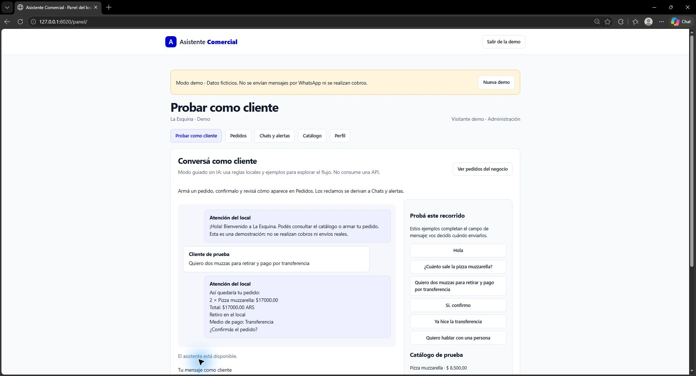
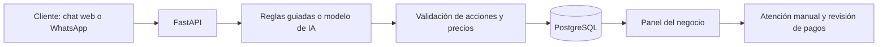

# Asistente Comercial IA

Asistente conversacional para pequeños comercios: interpreta consultas y pedidos, calcula precios desde el catálogo y permite que una persona tome el control de una conversación.

**Proyecto de portfolio con demo local reproducible.** Incluye un modo guiado sin claves y una integración opcional con modelos de IA. Los pagos de la demo son simulados.



## Probar en pocos minutos

Requisitos: **Python 3.11 o superior** y **Docker con Compose**, encendido. No necesitás cuenta de Meta, Mercado Pago ni una clave de IA para explorar el flujo.

Desde la carpeta del proyecto:

```sh
python start_demo.py
```

Abrí **http://127.0.0.1:8020/panel/** y elegí **Probar demo**.

El iniciador genera secretos locales en `.demo.env`, construye el backend, levanta PostgreSQL, aplica las migraciones y espera a que la app esté disponible. La primera ejecución descarga dependencias. La demo usa una base independiente de la configuración de desarrollo y publica el panel únicamente en la computadora local.

Cada visitante obtiene un negocio ficticio separado, diez productos y tres pedidos de ejemplo. La sesión dura una hora. Para empezar de nuevo, elegí **Nueva demo**; los espacios vencidos se limpian cuando se crea otra sesión. La instalación admite hasta 100 espacios simultáneos y cada uno hasta 120 mensajes.

Para detenerla conservando los datos:

```sh
docker compose --env-file .demo.env -f compose.demo.yml down
```

## Qué podés hacer

- Conversar como cliente desde la página y consultar el catálogo.
- Armar un pedido, revisar el resumen y confirmarlo explícitamente.
- Ver el pedido en el panel del negocio y cambiar su estado.
- Simular un pago aprobado o rechazado sin mover dinero.
- Avisar de una transferencia y comprobar que sigue pendiente de verificación.
- Generar un reclamo, atender ese chat manualmente y devolver el control al asistente.
- Explorar el catálogo, la disponibilidad y los datos ficticios del perfil.

Seguí el [recorrido paso a paso](docs/DEMO_WALKTHROUGH.md). También podés ver el [recorrido visual de la demo](docs/media/demo-tour.mp4), compuesto por capturas del panel; no representa una transacción real ni una grabación de WhatsApp.

## Modo guiado e IA real

| Modo | Interpretación | Configuración | Consumo |
| --- | --- | --- | --- |
| Guiado, predeterminado | Reglas locales; lenguaje limitado | Ninguna clave | No llama una API de IA |
| Ollama | Modelo local; mensajes libres | Ollama y un modelo descargado | Recursos del equipo que aloja el backend |
| OpenAI | Modelo remoto; mensajes libres | Clave y modelo propios | Saldo de API de quien configura la clave |

El modo guiado permite evaluar la lógica comercial sin configurar servicios externos. **No se presenta como un modelo de IA activo.** Para evaluar comprensión de lenguaje libre, seguí la [configuración de integraciones](docs/INTEGRATIONS.md) y repetí las pruebas con el modelo elegido.

Una respuesta generada por un modelo no acredita pagos ni decide los precios: el backend valida las acciones y calcula el total con los productos del negocio.

## Decisiones de diseño

- **Separación por negocio:** las consultas operativas filtran por el negocio de la sesión. La demo crea datos propios para cada visitante.
- **Confirmación explícita:** el resumen y la creación del pedido son pasos diferentes; una duda o condición no debe autorizar el pedido.
- **Pago separado del pedido:** una transferencia declarada por el cliente genera una alerta y permanece pendiente de verificación.
- **Atención humana por chat:** tomar control pausa esa conversación; una respuesta que estaba siendo generada se descarta si cambió la atención.
- **Eventos repetidos:** los identificadores de evento evitan procesar dos veces el mismo mensaje.
- **Demo aislada:** una sesión de demostración tiene permisos limitados y no puede vincular proveedores ni enviar mensajes reales.



La demo web reutiliza el procesamiento de conversaciones y las validaciones comerciales. El transporte real de WhatsApp añade validación del webhook, cola de respuestas y un worker separado.

## Tecnologías

Python, FastAPI, Pydantic, SQLAlchemy, PostgreSQL 16, Alembic, autenticación JWT, HTML, CSS y JavaScript. Docker Compose para la demo. Ollama u OpenAI para interpretación opcional. Adaptadores de WhatsApp Cloud API y Mercado Pago para desarrollo con credenciales propias.

## Pruebas

Con una base PostgreSQL de prueba y las variables de entorno configuradas, desde `backend`:

```sh
python -m pip install -r requirements-dev.txt
python -m alembic upgrade head
python -B scripts/check_conversation_guards.py
python -B scripts/check_chat_alerts.py
python -B scripts/check_portfolio_demo.py
```

Estas pruebas cubren validación de salidas del modelo, atención humana durante una generación, alertas, aislamiento de la demo, eventos duplicados y pagos simulados. Crean y eliminan sus propias fixtures. No envían mensajes reales ni cobran dinero.

El flujo de [GitHub Actions](.github/workflows/checks.yml) repite las pruebas sobre una base vacía en cada push y pull request. Las pruebas con IA real son adicionales, dependen del modelo y pueden consumir recursos o saldo; no se ejecutan en ese flujo.

## Estructura

```text
backend/app/api/          Endpoints y adaptadores de servicios
backend/app/services/     Conversaciones, reglas comerciales y proveedores
backend/app/models/       Modelos persistidos
backend/app/schemas/      Validación de entradas y respuestas
backend/alembic/          Migraciones de base de datos
backend/scripts/          Pruebas y revisión de archivos publicables
frontend/public/          Panel y chat de demostración
docs/                    Recorrido, arquitectura e integraciones
compose.demo.yml         Instalación aislada de la demo
start_demo.py            Iniciador de la demo local
```

## Alcance y límites

- Es una demostración de portfolio, todavía no una plataforma lista para operar comercios en producción.
- La demo no genera números telefónicos, no envía WhatsApps y no conecta cuentas financieras.
- La conexión autónoma de números de otros negocios mediante Meta Embedded Signup está pendiente de implementación y habilitación.
- El control humano del panel está implementado; detectar automáticamente las respuestas enviadas desde la app del celular requiere completar los eventos de coexistencia.
- La integración de pagos reales requiere credenciales propias, pruebas del proveedor y validación adicional antes de mover dinero.
- El modelo puede equivocarse. Cambiarlo requiere repetir los casos de interpretación y ambigüedad.
- La demo predeterminada es local. Publicarla requiere alojamiento, HTTPS, límites de uso, mantenimiento y controles de operación adicionales.
- Las pruebas automáticas con dobles no sustituyen una validación completa de WhatsApp o del proveedor de pagos.

## Decisiones, compromisos y crecimiento

La primera versión prioriza que se pueda comprender y probar el flujo completo en una instalación local. Estas decisiones reducen la configuración inicial, pero no sustituyen el trabajo necesario para operar con muchos comercios.

| Decisión actual | Motivo | Límite y siguiente paso |
| --- | --- | --- |
| Monolito modular en FastAPI, con servicios separados de los endpoints | Mantener sencillo el desarrollo y las transacciones de pedidos | Medir primero; separar procesos de inferencia y transporte cuando la carga lo justifique. No hay benchmarks de capacidad ni garantías de disponibilidad. |
| PostgreSQL y Alembic | Persistir pedidos, historial, eventos y migraciones reproducibles | Incorporar copias de seguridad, pruebas de restauración, índices revisados con carga real y una política de conservación de datos. |
| Precios y pagos bajo control del backend | Una salida del modelo no debe cambiar un precio ni acreditar dinero | Completar auditoría de operaciones, conciliación y pruebas del proveedor antes de realizar cobros reales. |
| Negocio identificado desde la sesión y filtros por negocio | Evitar confiar en un identificador elegido por el cliente | Auditar todas las rutas fuera del modo demo y ampliar las pruebas de permisos; evaluar restricciones adicionales en la base de datos. Los filtros de aplicación no equivalen a aislamiento físico. |
| Demo aislada y guiada por defecto | Permitir evaluación sin claves, costos de API ni autorizaciones externas | Es una demostración con reglas, no prueba la comprensión de un modelo. La IA real se habilita de forma opcional y se evalúa por separado. |
| Ollama u OpenAI intercambiables en configuración | Facilitar desarrollo local o uso de un modelo remoto | Las respuestas, latencias y costos varían. Cada cambio de modelo requiere evaluación; no se ha validado igual calidad entre proveedores. |
| Historial acotado y estado del pedido persistido | Dar contexto al modelo y limitar el tamaño de cada consulta | Para conversaciones largas, diseñar memoria resumida y recuperación de contexto sin perder restricciones ni datos del pedido. No hay aprendizaje automático a partir de mensajes de clientes. |
| Cola en PostgreSQL y bloqueos de procesamiento | Reutilizar infraestructura y evitar respuestas duplicadas o enviadas durante una toma de control | El comportamiento funcional está probado, pero faltan pruebas de carga, límites por negocio, seguimiento de reintentos y recuperación operativa. Evaluar una cola dedicada si las mediciones lo requieren. |
| Control humano por conversación | Permitir intervención sin detener los demás chats | Completar la sincronización de respuestas realizadas desde el celular y registrar quién tomó control, respondió o confirmó un pago. |
| Sesiones de demo de una hora y límites de espacios y mensajes | Mantener acotada una instalación de evaluación | No reemplazan protección contra abuso. Un despliegue público requiere límites por origen, cuotas de IA, expiración operativa, métricas y controles adicionales. |
| Interfaz con HTML, CSS y JavaScript | Evitar una compilación adicional y mantener el proyecto fácil de ejecutar | Si crecen las pantallas y la colaboración, evaluar componentes, tipado y pruebas de interfaz antes de elegir una migración. |

### Qué falta para operar con otros negocios

1. **Alta de negocios y WhatsApp:** habilitación de Meta como proveedor, permisos revisados y registro integrado; guardar conexiones por negocio, manejar revocaciones y procesar eventos de coexistencia. Un número de prueba de Meta sirve para demostraciones coordinadas con destinatarios habilitados, no como canal público para cualquier visitante ni como un número generado por nuestra app.
2. **Cobros reales:** probar el ciclo completo con el entorno del proveedor, verificar firmas, estado, importe y titular, manejar eventos repetidos, devoluciones y conciliación. La simulación y los dobles de pruebas no verifican dinero recibido.
3. **Seguridad e identidad:** revisión de todas las rutas y permisos del modo de desarrollo, recuperación y renovación de acceso, protección contra abuso, gestión y rotación de secretos y registro de acciones sensibles.
4. **Operación permanente:** alojamiento HTTPS, base administrada o mantenida, copias de seguridad con restauración probada, migraciones controladas, monitoreo y alertas de fallos.
5. **IA a escala:** evaluaciones versionadas con conversaciones representativas, presupuesto por comercio, concurrencia y tiempos de respuesta medidos, derivación humana ante incertidumbre y manejo explícito de caídas del proveedor.
6. **Privacidad:** consentimiento y políticas aplicables, retención y eliminación de conversaciones y comprobantes, acceso restringido y minimización de datos enviados al modelo.

La ruta propuesta es cerrar primero un piloto supervisado con pocos usuarios, medir fallos y tiempos y después ampliar el alcance. Este repositorio no afirma soportar una cantidad determinada de comercios ni haber completado una certificación o validación financiera de producción.

## Credenciales y publicación

El repositorio debe incluir únicamente configuración de ejemplo. `.env`, `.demo.env`, claves, datos personales y reportes locales están excluidos. Antes de publicar:

```sh
python -B backend/scripts/check_public_files.py
```

El control detecta algunos formatos de credenciales y nunca imprime sus valores; no garantiza detectar todos los secretos. Si ya existe historial Git, también debe revisarse. Una credencial que se haya publicado debe revocarse aunque después se borre del código.

El modo demo bloquea operaciones con proveedores reales y no necesita tu saldo personal para funcionar. Para IA real, quien ejecute la instalación configura sus propios recursos.
